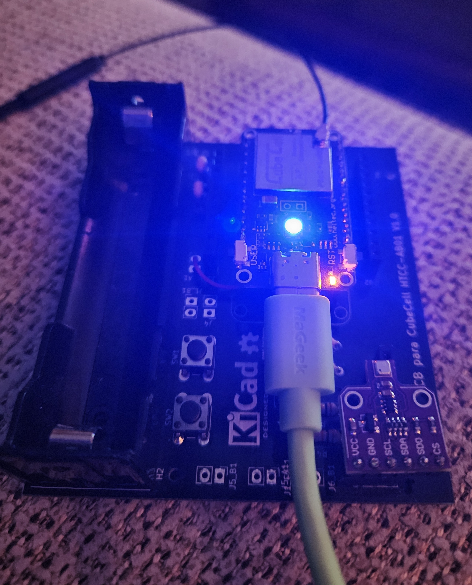
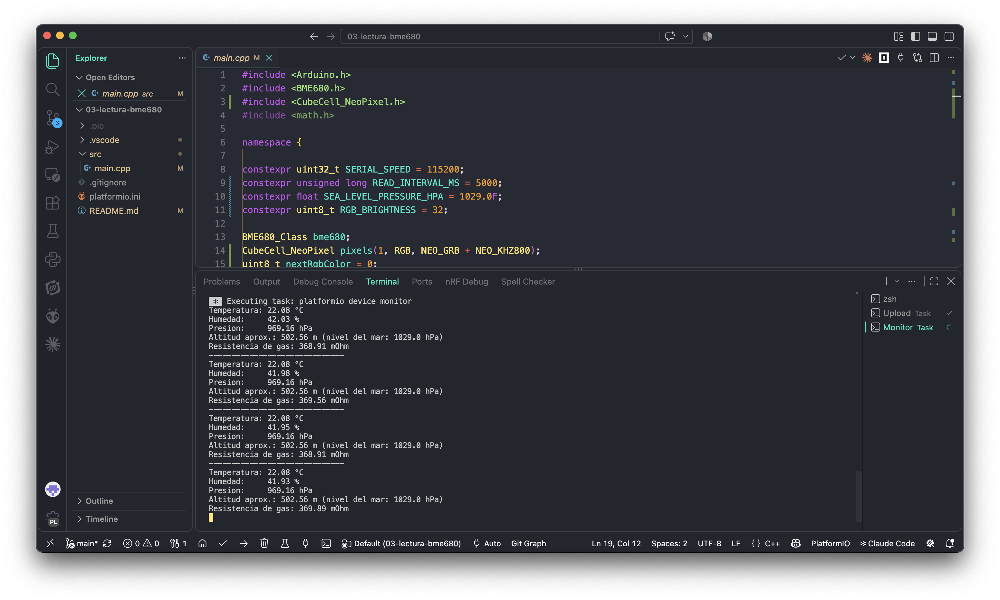

# 03 - Lectura del sensor BME680

Ejemplo independiente para comprobar un BME680 conectado a una Heltec CubeCell. Usa la clase `BME680_Class` incluida en el framework de Heltec, lee temperatura, humedad, presión y resistencia de gas por I²C, muestra los valores por el monitor serie y cambia el LED RGB integrado entre rojo, verde y azul en cada lectura. No realiza una conexión LoRaWAN ni calcula un índice IAQ.

## Hardware

- Heltec CubeCell Board compatible con `cubecell_board_v2`.
- Módulo sensor BME680.
- Conexión entre ambos dispositivos: Vext, GND, SDA y SCL.

Conecta SDA y SCL a las líneas I²C de la CubeCell o de la placa adaptadora. Conecta VCC del módulo a **Vext** (salida de 3,3 V controlada por la CubeCell) para que el sensor quede alimentado mientras corre este ejemplo. Comparte GND.

La clase de Heltec busca automáticamente el sensor en las direcciones I²C habituales `0x76` y `0x77`.

<p align="center">
  
</p>

## Compilar y cargar

Abre esta carpeta como proyecto PlatformIO, compila y carga el firmware. No se necesita instalar otra biblioteca: `BME680_Class` forma parte de `Sensor_ThirdParty` del framework CubeCell.

Abre el monitor serie a **115200 baudios**. El sensor se lee cada 5 segundos y el LED RGB avanza por los colores rojo, verde y azul tras cada lectura. La salida será similar a:

```text
CubeCell - Lectura del BME680 (Heltec)
BME680 inicializado. Lecturas cada 5 segundos; RGB rojo, verde y azul.
------------------------------
Temperatura: 23.41 °C
Humedad:     46.20 %
Presion:     1008.35 hPa
Altitud aprox.: 170.69 m (nivel del mar: 1029.00 hPa)
Resistencia de gas: 2874.00 mOhm
```

Los valores del ejemplo son ilustrativos y variarán según el sensor y el entorno.

## Resultado



## Notas

- La lectura de gas es una resistencia, no un índice IAQ ni una medición directa de CO₂ o TVOC.
- El brillo del LED RGB se ajusta con `RGB_BRIGHTNESS` (actualmente 32 sobre 255).
- La altitud es una estimación calculada suponiendo una presión al nivel del mar configurable en `SEA_LEVEL_PRESSURE_HPA` (actualmente 1029 hPa).
- La clase Heltec expresa temperatura en centésimas de °C, humedad en milésimas de porcentaje, presión en Pa y gas con la escala que imprime el ejemplo oficial (`gas / 100`, mOhm).
- Si no aparece el sensor, comprueba Vext, GND, SDA y SCL.

## Referencia y licencia de la biblioteca

La configuración está basada en el ejemplo oficial [BME680_test.ino](https://github.com/HelTecAutomation/CubeCell-Arduino/blob/master/libraries/Sensor_ThirdParty/examples/BME680/BME680_test/BME680_test.ino). El código de `BME680_Class` incluido en el framework declara licencia GPL-3.0; esta dependencia conserva su licencia propia y es distinta de la licencia MIT del código original del proyecto.
